# Koko audit: getting to 2027

Audit date: 17 November 2026. Recommend-only: no app code was changed, nothing was committed.
Screenshots are in [`docs/koko-audit/`](koko-audit/). Every finding is labelled:
**[C]** confirmed (seen in the app or read in the code), **[I]** inferred, **[O]** my opinion.

---

## Assumptions

1. **"Live" means `origin/main` (commit `e9f4c36`).** I hashed `app.js`, `styles.css`, `place.js`, `book.js`, `index.html` and `config.js` on https://dubai-bites-pi.vercel.app against `origin/main`. They match. The working branch `map-art` is two commits ahead (Places record phases 1 and 2, not pushed). Where those commits change a screen (check-in search, the new-place card, List, the place page), I say so.
2. **No real accounts were touched.** I used the app's own `?local` mode, the mode the project's e2e suite uses, with the built-in sample crew (Maya, Omar, Layla, Kabir, Noor). On the live URL, signed-in screens were set up in the page with the app's own store. No codes were typed on the production host and nothing was sent to Supabase. The email-code, handle, avatar and crew-setup steps were walked on a local copy, and that onboarding code is identical to live.
3. **Final submits were not run against the real backend.** Saving a visit, creating or joining a crew, planning and RSVPs would notify the real friend-testers. I ran those in `?local` and read the rest from the code.
4. **Not exercised, audited from code:**
   - the Google sign-in round trip
   - real email delivery
   - push reminders
   - the real Supabase sync and conflict path
   - iPhone hardware
   - the Android share sheet on a device
   - the Capacitor Android build, which does not exist: no `capacitor.config`, no `android/` project, and project notes say it was deliberately not started.
5. **Test devices.** Headless Chrome emulated a phone with touch at 360×780, 390×844 and 430×932. A "mid-range phone" means a 4× CPU slowdown. "Fast 4G" means 9 Mbps with 60 ms round trips. "Weak signal" means 400 kbps with 400 ms round trips.
6. **The six objectives are ranked in the order given.** Logging fast is the most important.
7. **"2027" is judged from 2025–26 sources plus judgement.** No source can describe 2027 yet, except colour forecasts. Every trend claim links to a source. Everything else is marked [O].

---

## The short version

- **The two parts only Koko has already look current: the pixel city and the paper scrapbook pages.** The chrome around them looks like a careful 2022–24 template: white rounded cards on beige, every settings row its own card, Material icons, and Plus Jakarta Sans. That is where the dated feel comes from. [O, from the screenshots]
- **Logging is not "seconds at the table".** Checking in to a place already on the map takes 6 taps, a typed search and 1.6 screens of scrolling. A new place takes 8–11 taps. The one required choice, "Who's this for?", sits 2.1 screens down a form 2.6 screens tall (measured at 390 px). [C]
- **Search is excellent under the hood and fragmented on screen.** It handles typos, synonyms, dishes, people and months, offline. But there are three different search boxes (Map, List, Shelf) with different behaviour, the bar sits at the top of the screen, and on the map the results open under an open place card. [C]
- **The map is the hero visually, not functionally.** At the default zoom, crew pins are count stamps with no faces. Cream stamp paper on desert sand is 1.30:1 contrast. Three rows of chrome (about 180 px) sit above the map. [C, measured]
- **Two trust bugs, both small fixes:**
  - The sign-in screen has a working tab bar, so signed-out people can open Check in, Crew and an empty Shelf.
  - The crew screen always says "All sync'd". It is fixed text, whatever is waiting to send. [C]
- **73% of the first load is one icon font.** It weighs 2.32 MB of a 3.2 MB first load, and `display=block` hides every icon until it arrives. The 142 icons the app uses subset to 22 KB. [C, measured]
- **Gamification has crept past "stickers and critters only".** There are crew challenges, personal goals, capacity bars and "3/51 areas" counters. [C] Cut them. [O]
- **Scrapbook spec status.** Phases 1–3 are built and live. Phase 4 (cut-out stickers and the "Mine" tray, plus page-flip video export) is not built, and is blocked on choosing a cut-out approach. [C]
- **Recommended direction: pixel for the city, paper for memories, quiet ink for everything else.** In practice:
  - a full-bleed map with a bottom sheet holding search, results and the place card
  - "who is this for" becomes the save button itself
  - one variable typeface whose rounded axis echoes the wordmark, with a pixel face only for the map's own voice
  - restrained tactile motion
  - privacy shown as a consistent colour and icon everywhere.

---

## A. Journey and flow map

How to read the tap counts: a tap is a deliberate press. Typing and scrolling are listed separately. Scroll lengths are in "screens" of visible content: 775 px above the tab bar on a 390×844 phone, measured on live.

### A1. First run: sign in, handle, avatar, first map

```mermaid
flowchart LR
  W["Welcome<br/>(map drifts, crew pins drop)"] -->|Continue with Email| E[Email] --> C[6-digit code]
  W -->|Continue with Google| G[Google account picker]
  C --> H["1 · Handle + display name"]
  G --> H
  H --> AV["2 · Pixel avatar + pin colour"] --> WS["3 · Who sees each place<br/>(read-only)"] --> CO["4 · Three things you'll collect<br/>(read-only)"] --> CR["5 · Crew: create / join / continue solo"]
  CR --> M["Map + 'Your map looks empty'"]
  M -->|Pin my first place| T["16-step spotlight guide"]
  M -->|Skip the tour| EM["Empty-map card"]
```

| Step | Screen and states | Taps |
|---|---|---|
| 1 | Welcome: Google, Email, legal line. With an invite link it also shows the crew's name, size and owner. | 1 |
| 2 | Email entry → Send | 1 + typing |
| 3 | Code entry → Verify | 1 + typing |
| 4 | Handle: live availability, two rule pills, optional display name, and a sample "how your crew sees you" card | 1 + typing |
| 5 | Avatar builder: skin, hair, colours, outfit, pin colour. Defaults are pre-filled. | 1 |
| 6 | "You decide who sees each place" (explainer) | 1 |
| 7 | "Three things you'll collect" (explainer) | 1 |
| 8 | Crew: Create or Join, name, invite link, preview → "Continue to Scrapbook" | 1 |
| 9 | Map with the guide card → Skip, or Pin my first place (16 steps) | 1 |

**Total: 9 taps and 3 typed fields (email path), or 8 taps (Google), to reach an empty map.** The first stamp (the real value) needs the logging flow on top: 6–11 more taps.

Flags:
- **Bug: the tab bar is live on the welcome screen.** [C, live] `onboarding.js:21` builds the welcome as `screen in` without the `cover` class. `styles.css:1464` only hides the bar for `.cover` screens. So signed-out people can tap +, Check in, Crew, List and Shelf. The Shelf opens empty ([03-signed-out-bugs](koko-audit/03-signed-out-bugs.jpg)), and the legal line scrolls under the bar.
- **Two progress indicators on every setup step.** A "Step 2 of 5" chip and five bars. [C] Commit `c0078d8` set out to have one.
- **Two of the five steps are read-only.** Steps 3 and 4 have nothing to choose. [C] They explain things at the wrong moment: the privacy rule matters at the first save, and collectables matter at the first sticker. [O]
- **The handle step shows an invented feed card** ("logged a spot at Trio Cafe… Iced Spanish Latte & Brioche"). [C] It is noise on a step that should take five seconds. [O]
- **The crew step contradicts itself.** It says "Share places with up to 14 friends" while its own pill says "Up to 15". [C]
- **"Pin my first place" starts a 16-step spotlight guide** (`tour.js:15–36`). It covers search → add → area → kind → rate → photo → who → save, then the stamp, Me/Crew, filters, bell, crew, shelf and critters. [C] That is a second onboarding. [O]
- **States I could not exercise:** a code that fails to arrive, a wrong code, Google cancel. Code paths exist for some, untested here.

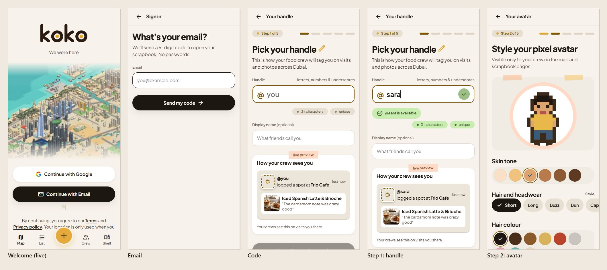
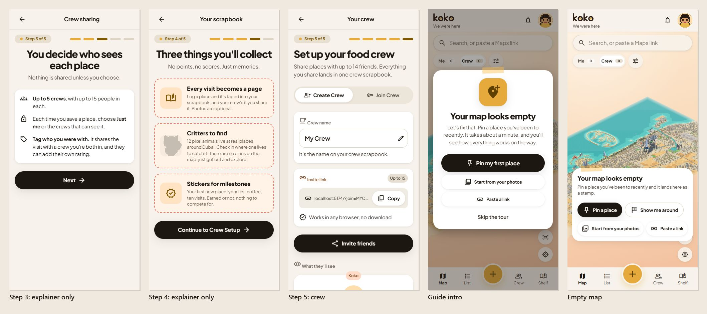
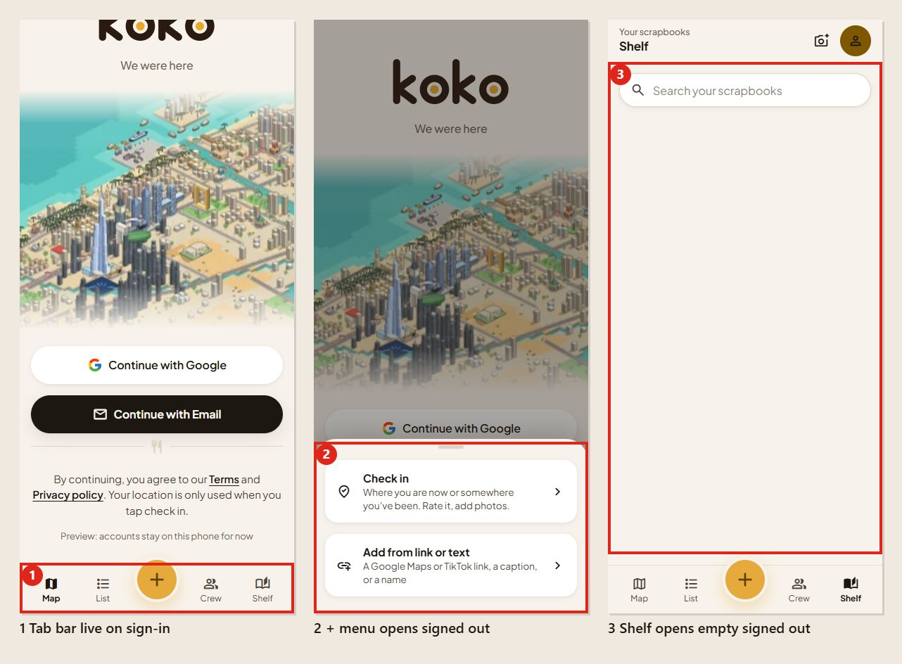

### A2. Crews: join by link or code, create, leave

| Path | Steps | Taps |
|---|---|---|
| Join by link, new person | Link → welcome shows the crew (name, size, owner avatar, via `crew_invite_preview`) → sign in → 4 setup steps → crew step opens on Join with the code filled in → Join | about 9 + typing |
| Join by link, signed in | Link → "You're invited to …" → Join | 1 |
| Join by code | Crew tab → New or join → Join Crew → type code → Join | 4 + typing |
| Create | Crew tab → New or join → name (default "My Crew") → Invite friends / Copy → Done | 3–4 |
| Leave | Crew tab → scroll to the foot → Leave X → confirm | 3 |
| Switch crew on the map (2+ crews) | Tap "Crew" again on the map. The only hint is the "▾" in the label and an aria-label. | 2 |

Flags:
- **"All sync'd" is fixed text** (`crew.js:150`). It shows whatever the outbox holds, offline included. [C] For an app whose promise is trust, this is the most important copy bug. [O]
- **Invite links read `dubai-bites-pi.vercel.app/?join=…`** ([09-crew](koko-audit/09-crew.jpg)). [C] Friends see an old product name in the one link they all receive. [O]
- **Gamified framing for a social space.** A members capacity bar, "6 of 15 members aboard", "9 spots open", "Fellow explorers" and "Food journal". [C] It breaks the spec's own copy rule ("say what things are… without themed filler"). [C]
- **Good:** offline join and leave say "You're offline" plainly, full and over-limit crews get clear alerts, and the leave confirmation explains what happens to shared posts. [C]
- **Gap:** nothing tells a new member what they will now see. For example: "You'll see 37 places Sample Crew shared. Your past visits stay yours until you share them." [O] This is out of scope as a feature, so it is noted as copy only.

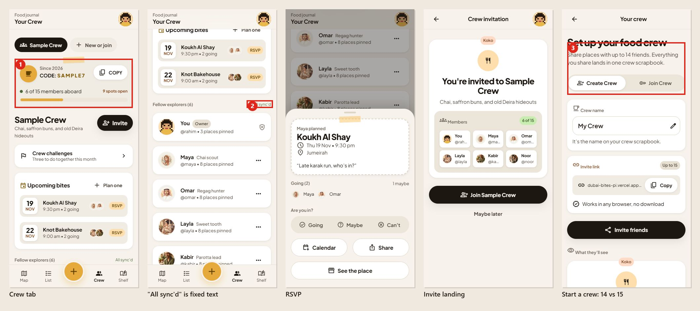

### A3. Browsing the map

| Action | How | Taps |
|---|---|---|
| Me ↔ Crew | Segmented control under the search bar | 1 |
| Filter | Filter button → a two-screen sheet in six numbered sections → Apply | 3+ |
| Cluster | Tap a count stamp → zoom, or the "N spots here" list | 1–2 |
| Area | Tap an area label (20 px tall) → area sheet | 1 |
| Landmark | Tap the sprite → card with fact, "Add a pin here", directions | 1 |
| Place | Tap a pin → peek card → Details → place page | 1–2 |
| Day ↔ night | Automatic ("Dynamic" follows Dubai sunrise and sunset) | 0 |

Flags ([04-map](koko-audit/04-map.jpg)):
- **The map sits under about 180 px of chrome:** a wordmark header with tagline, the search bar, and the Me/Crew + filter row. [C] The spec says "at most two rows including the header". It now has three. [C]
- **At the default zoom, crew pins are count stamps with no faces.** Faces appear only close up, at 18 px. [C] Objective 3 asks for profile pictures on pins. [C]
- **Cream stamp paper on desert sand is 1.30:1 contrast. The gold selection ring on sand is 1.44:1** (sampled from the live map). [C] At night the same stamps pop (11.5:1). [C] Day legibility depends on the dashed brown edge alone.
- **The peek card and tab bar cover the bottom 43% of the screen.** [C] Its primary button says **"Add Bite"**, a leftover from "Dubai Bites"; everywhere else this action is "Check in". [C]
- **Search results open under an already-open peek card** ([04-map](koko-audit/04-map.jpg), frame 3). [C]
- **Blurred translucent buttons sit over the pixel art** (`backdrop-filter`, 7 uses). Blur turns hard pixels to mush. [C, O]
- **States:**
  - Loading: "Building Dubai…" with the pin loader, then cached overviews on later launches.
  - Empty: "Your map looks empty" with four routes in.
  - Location: plain toasts for denied, error, and "outside the map".
  
  If the map renderer fails, errors only go to the console (`map.js:1872`). There is no on-screen state. [C]
- **Good:** level-of-detail clustering, a label budget with collision avoidance, landmark cards, light shows, night lights. The city genuinely feels alive. [C]

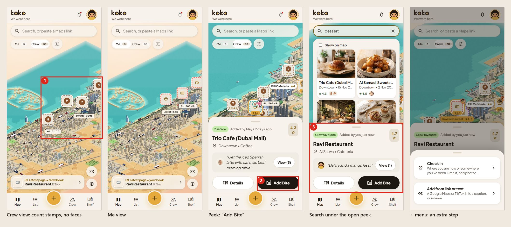
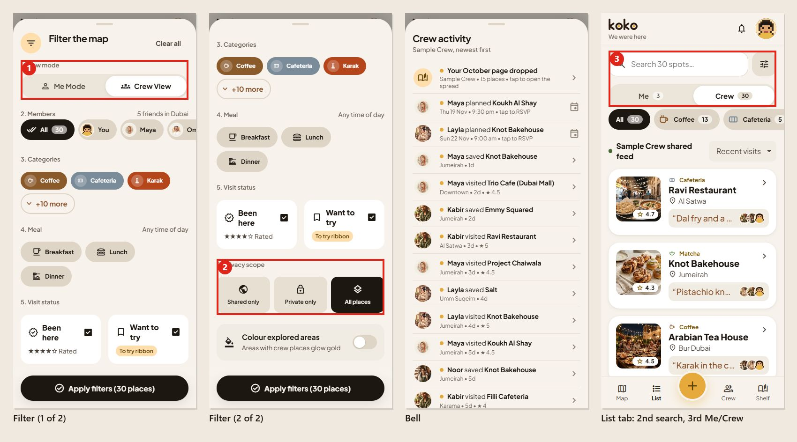

### A4. Logging a visit: search or add, pin, rating, photos, meal, who, tags, check-in, save to try

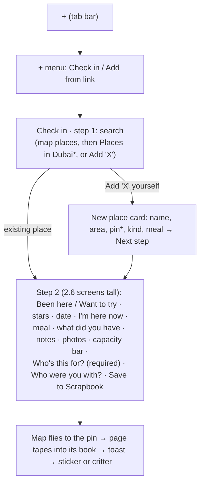
\* map-art only: the Overture listing and a required pin for hand-added places. Live still shows "Searching Google Maps…". [C]

| Variant | Taps (typing and scrolls aside) |
|---|---|
| Place already on the map, via + | 6: + → Check in → result → star → who → Save. Plus 1.6 screens of scrolling (the form is 2,017 px tall in a 775 px view). |
| …with one photo from the library | 8–9 |
| …as a real check-in (catches critters) | +1 ("I'm here now") and a one-time location prompt |
| From a place page (peek → Details first) | 6: pin → Details → Check in (finds you) → star → who → Save |
| New place (live) | 8–9: + → Check in → Add "X" → kind (+1 if behind "+10 more") → Next step → star → who → Save |
| New place (map-art, pin required) | 10–11 |
| Save to try, from a place | 5: pin → Details → Save to try later → who → Save to try |

Flags ([06-check-in](koko-audit/06-check-in.jpg)):
- **The one required field is the last one.** Nothing is pre-picked when you are in a crew (`ui.js:316` `whoDefault`). Saving without it scrolls you back with a toast. [C]
- **The + menu adds a step before every log.** Check in vs Add from link. The map search bar already accepts links ("Search, or paste a Maps link"). [C]
- **"⋮" on step 1 only shows a toast** (`place.js:365`). It is a dead control. [C]
- **"Scrapbook Roll Capacity 0 / 300" on every log** (`place.js:402`). [C] The limit matters at 280, not at 3. [O]
- **Ten starter dish chips** (pasta, pizza, burger…) take about 300 px before Notes and Photos. [C] Photos, the heart of a scrapbook page, start 1.7 screens down; "Who's this for?" starts 2.1 screens down. [C, measured]
- **The "already on the crew map!" banner uses a 📌 emoji** (the spec bans emoji in chrome) and takes about 160 px. [C]
- **The tab bar, including the gold +, stays visible inside the flow.** Tapping + again opens the + menu over the form. [C] A `check_circle` icon is used to mean "change place". [C]
- **Tagging costs** 1 tap per person in a sideways-scrolling chip row, or typing `@handle` in Notes. Tagging also shares with a crew you're both in, and the form says so before saving. [C]
- **States:**
  - Loading: "Searching Google Maps…" on live, "Looking through Dubai's places…" on map-art.
  - Error: "Couldn't open that place. Add it yourself."
  - Empty: "Where did you eat?" with a stamp.
  - Location: "I'm here now" turns into a distance line ("You're … away, so this saves as a visit, not a check-in").
  
  All plain and honest. [C]
- **Good:** the payoff after saving. The camera flies to the pin, the page tapes into its book, a VISITED stamp slams on, then any sticker or critter appears. This is the most "2027" moment in the app; keep it. [C, O]

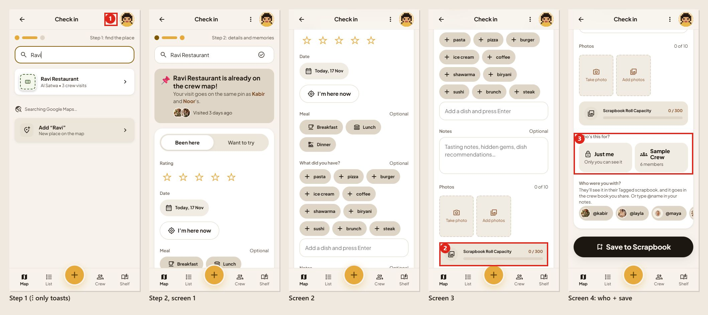
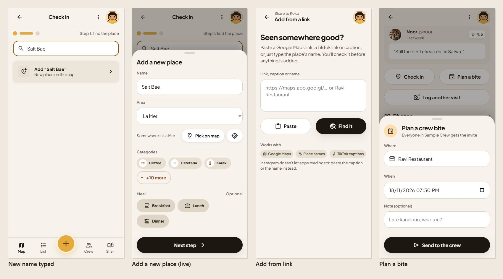
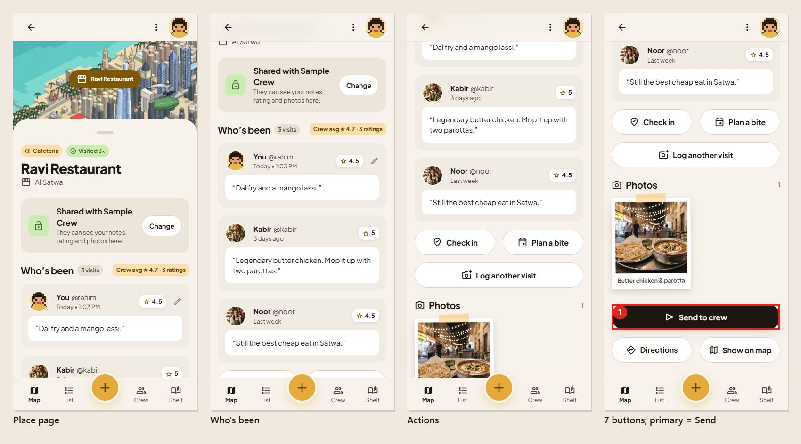

### A5. Add from link (Google Maps link or place name)

| Path | Taps |
|---|---|
| + → Add from link or text → Paste → Find it → confirm sheet → who → Add to want-to-try (or "I've been here") | 6 |
| Paste into the map search bar → "Add this place" → confirm → who → add | 5 |
| Android share sheet (installed PWA) → Koko → confirm → who → add | 2 in Koko |

Flags:
- **State coverage is strong.** Match, several candidates, needs place, already saved, unsupported, offline (goes to the Inbox), with Undo and "View on map". [C, SPEC]
- **The "Works with: Google Maps / Place names / TikTok captions" row is drawn as chips but isn't interactive** ([07-new-place-link-plan](koko-audit/07-new-place-link-plan.jpg)). [C] It looks tappable. [O]
- **The Inbox lives in the + menu** and only appears when shares are waiting. If + goes straight to Check in, the Inbox needs another home: the bell or the search sheet. [O]

### A6. Plan a bite, RSVP, the bell

| Path | Taps |
|---|---|
| Plan: pin → Details → scroll → Plan a bite → native date and time → Send to the crew | 5–7 |
| Plan from Crew tab: Upcoming bites → Plan one → search a place → time → send | 5–7 |
| RSVP: bell → plan row → Going | 3 |
| Bell: 1 tap → sheet, newest first (month drop, On this day, plans, tags with "Add your rating", visits, saves) | 1 |

Flags:
- **"Plan a bite" / "Upcoming bites" / "Plan one" are three names for one thing**, and "bite" is the old brand. [C]
- **On first open, every bell row shows the gold "new" dot** (`SEEN_KEY` starts at 0). [I, code] There is no day grouping, so 20 rows read as one list. [C]
- **The Plan sheet's date field has no label** (axe: `label` on `#evWhen`). [C]
- **Reminders need the app open or installed.** That is stated honestly in Settings. [C]

### A7. Finding a past place: "what was that place we went to?" and "where should we go for dessert?"

| Path | Taps |
|---|---|
| Map search: tap the bar → type ("karak", "Maya", "september", "ice cream with Rabia") → photo card → map flies to the pin and opens its card | 2 + typing |
| "Dessert?": search "dessert" (synonyms, dish tags, cuisine) → cards with photos, rating and faces; "Show on map" dims the rest | 2 + typing |
| By person or kind: filter sheet, or List chips and sort | 3–6 |
| From the scrapbook: Shelf → search, or open the Tagged or crew book | 2–4 |

Flags:
- **The engine deserves a better front end.** It is offline, ranked by your own dish tags and notes, typo-tolerant, and matches people and months. [C] It is the best-built objective in the app. [O]
- **Three search boxes:** map (full engine), List (plain substring match over name, area and notes), Shelf (pages). [C]
- **The bar is at the top of the screen.** [C] That is the hardest place to reach one-handed (Hoober's grip studies, linked in D). [O]
- **No quick scopes for the two core questions:** "places we've been" vs "places we want to try". [C] Want-to-try saves are only reachable through the filter's "Visit status" cards or the place page. [C]
- **Result titles truncate in the two-column cards** ("Trio Cafe (Dubai M…"). [C]

### A8. Scrapbook: shelf, book, page, decorate, share

| Path | Taps |
|---|---|
| Shelf tab → Everything → cover swings open → swipe or use the pager | 2 |
| Decorate: wand → tray (Starter, Milestones, Critters, Districts, Layout) → drag stickers, tape → Done | 3+ |
| Share a page: share icon → Story card → OS share sheet | 3 |
| Monthly drop: bell → "Your October page dropped" → turns to the spread → share card | 2 |

**Spec status.** The October scrapbook spec has phases 1–4.

| Spec item | Status |
|---|---|
| Shelf: Everything, Tagged, by kind, crews, albums, "A year ago today", latest pages | Built [C] ("A year ago today" needs year-old data, so it was seen in code only) |
| Book: hard cover, StPageFlip curl, pager with slider and jump, reduced-motion cross-fade, List toggle | Built [C] |
| Paper pages: grain, paper types, rubber-stamp rating, tilts, map postcard, note strip, handwriting | Built [C] |
| Feel layer: creak, flips, stamp slam, photos that develop, sounds off on web and on in Android | Built [C, code] |
| Sticker layer: decorate mode, tape, undo and redo, 12 per person, unlock-as-collection | Built [C] |
| Crew layers: others' stickers locked, "Mine only" | Built [C, code] |
| Monthly spread and the drop at 00:00 Dubai | Built [C]. pg_cron status was never confirmed (project notes) [I] |
| Sharing: story card, postcard, page links that expire | Built [C, code]. Page links need accounts, so they were not exercised. |
| "Mine" tray: cut-out stickers from photos (Stitch "Make-a-Sticker Studio") | **Not built.** Phase 4, blocked on choosing a cut-out method (not `@imgly/background-removal`, AGPL) |
| Page-flip video export | **Not built.** Phase 4 |
| Printed photobook | Parked (locked) |

Flags ([10-scrapbook](koko-audit/10-scrapbook.jpg)):
- **A book opens on page 1, the oldest visit** (spec: "oldest first, as a book reads"). [C] People mostly open a book to see what just happened. [O]
- **The shelf is 1.7 screens long with the sample data, and grows with every kind and crew. Its only filled button is "New Album".** [C] Crew spines truncate their names vertically ("Sample …"). [C] Spine and cover text is drawn at 4.6–9.9 px. [C]
- **Decorate tray tabs are uppercase Space Mono** ("STARTER", "MILESTONES"), breaking the spec's sentence-case rule. "DISTRIC…" is clipped at 390. [C]
- **The pages are the best thing in the app.** Polaroids, postage stamps, rubber-stamp ratings, the pixel map postcard. [O]

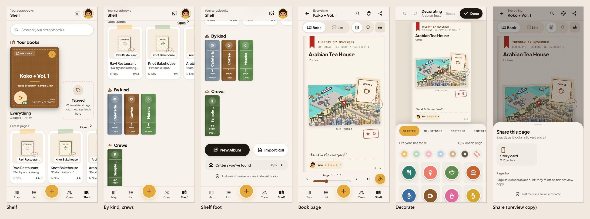

### A9. Profile, stickers, critters, goals

The avatar in the header opens the profile ("Scrapbook passport"). It holds a favourite critter, stats (places, visits, "3/51 areas", photos), a stickers row, crew challenges, the month's spread and favourite kinds. Stickers, critters and goals are each 1 more tap. ([11-profile-settings](koko-audit/11-profile-settings.jpg), [12-collectables-goals](koko-audit/12-collectables-goals.jpg))

Flags:
- **Crew challenges and personal goals are a third reward layer** ("Try 3 new restaurants", "5 places new to the crew", "chipped in" with faces), alongside stickers and critters. [C] The brief limits gamification to stickers and critters. [C]
- **"3/51 areas" and the members capacity bar are progress counters**, the thing the points removal set out to avoid. [O]
- **Critters and stickers are good:** silhouettes with "? ? ?", "no clues", earned-or-not milestones, "nothing to compete for". [C]

### A10. Settings, backup export, theme

Avatar → gear → a list 4.2 screens long ([11-profile-settings](koko-audit/11-profile-settings.jpg)). Theme is a four-way segment (Light, Dark, System, Dynamic). Export backup downloads one file. Import, Replay the guide, legal pages, Sign out and Delete account follow.

Flags:
- **"Koko is free. Buy me a karak?" with PayPal is the first card**, above Account. [C] Asking for money before a friend-tester has edited their own name sets the wrong tone. [O]
- **Every row is a separate white card.** Toggles are only tappable on the 52×30 switch; the row itself doesn't toggle (`profile.js:95`). [C]
- **"Preview with a sample crew" is a tester tool in the main list.** [C]

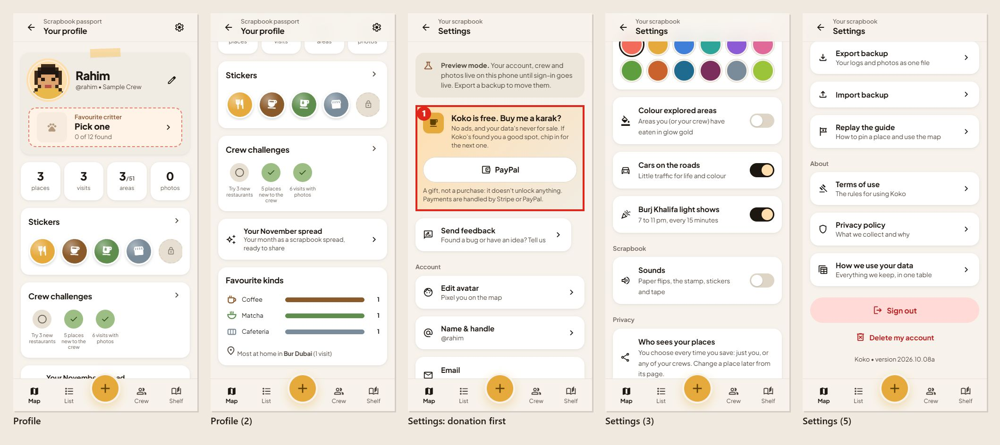
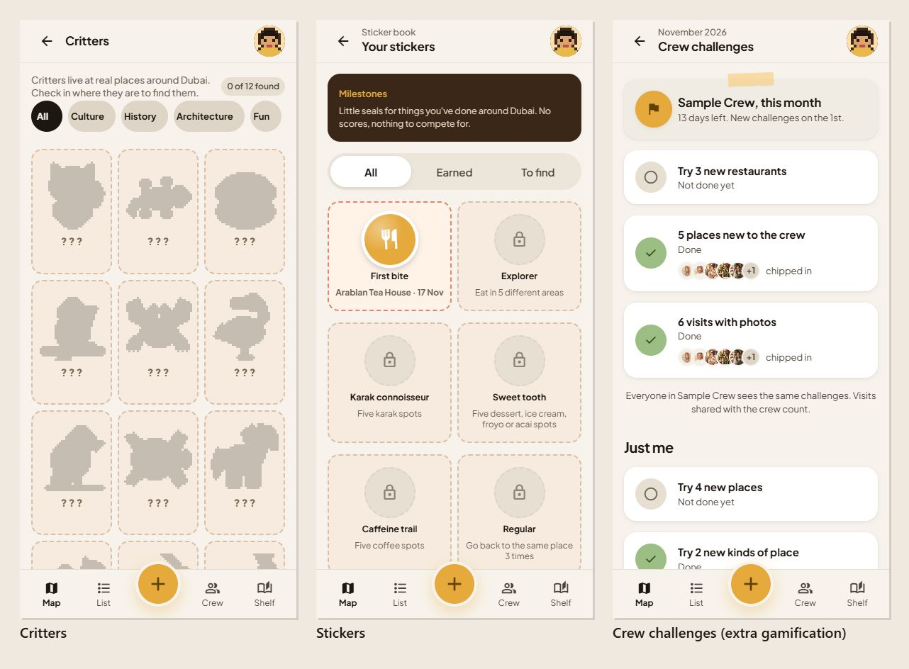

### A11. Offline use and sync

- **What happens:**
  - Screens read the phone's copy, so the app opens and works offline. [C]
  - Writes go to a per-person outbox and are sent in order (`cloud.js:254–317`). [C]
  - A write the server refuses is undone with "One change couldn't be saved to your account, so it was undone." [C]
  - Joining and leaving crews need a connection and say so. [C]
  - Shares made offline wait in the Inbox, with a "Back online" nudge. [C]
- **What you see: nothing, most of the time.**
  - There is no offline banner, no "3 changes waiting" indicator and no per-item pending state. [C]
  - The only sync wording in the app is the fixed "All sync'd". [C]
- **Conflicts:** the server's rules win. Ratings say "the server keeps the newest" (spec). Same-row edits from two phones are last-write-wins with no notice. [I]
- **Service worker:** network-first for same-origin files, cache fallback. Fonts and the Supabase client come from Google Fonts and jsdelivr and are not cached by the worker (`sw.js:39`). [C] Measured on live after one visit:
  - weak signal: usable map in about 3.4 s on a slowed phone [C]
  - offline: about 3.7 s, icons intact (from the HTTP cache), and no sign of being offline [C]

### A12. The Android Capacitor build

**Status: not built.** [C] There is no Capacitor project in the repo. What exists:
- adaptive icon layers (`native-assets/android/`)
- a `native()` check in `feel.js` that switches sounds on by default and uses Capacitor Haptics
- history-based back navigation that the Android back button will drive
- `env(safe-area-inset-*)` padding
- `viewport-fit=cover` and theme-color metas [C]

Readiness risks:
- **Android 16 (targetSdk 36) forces edge-to-edge.** The old `@capacitor/status-bar` overlay and background settings no longer apply, and Capacitor 8's SystemBars handles insets. [[Capawesome guide](https://capawesome.io/blog/capacitor-edge-to-edge-and-safe-areas-guide/)] The bottom bar and sheets must pad for the gesture area. The app already uses `--safe-b`. [C]
- **The left-edge swipe-back (`edgeSwipe` in `ui.js`) will compete with Android's system back gesture.** [I]
- **Offline first launch.** Fonts and the Supabase client come from CDNs, so an offline first launch of the APK would show icon names as words ("notifications") until they load. [I] Bundle them.
- **Fixed px text and system font size.** Text sizes are fixed px. Decide how Android's font-size setting maps to WebView `textZoom` before release. [I]

---

## B. Goal alignment

| # | Objective | Score | Evidence | Where intent breaks |
|---|---|---|---|---|
| 1 | Logging takes seconds | **Weak** | 6 taps, a typed search and 1.6 screens of scrolling for a known place. 8–11 taps for a new one. [C] | The required "who" comes last. The + menu adds a step. Optional fields come before photos. The capacity bar. A dead "⋮". |
| 2 | Retrieval is quick and obvious | **Partial** | A strong offline engine with typos, synonyms, dishes, people and months. [C] | Three different search boxes. The bar is at the top. No been / want-to-try scopes. Results open under the peek. Truncated result titles. |
| 3 | The map is the hero | **Partial** | Exceptional art, light shows, night city, landmark cards. [C] | Pins blend into sand (1.30:1). No faces at the default zoom. Three rows of chrome. The peek covers 43%. Blur over pixel art. |
| 4 | The scrapbook is satisfying and shareable | **Strong** | Every visit is a page. The book, stickers, monthly drop and story cards are all built. [C] | It opens on the oldest page. A long shelf with "New Album" as primary. Page links unproven here. Phase 4 unbuilt (status). |
| 5 | Crews are easy and privacy is never in doubt | **Partial** | Privacy enforced by row-level security and tested in `sqltest.mjs`. Lock chips, a "Shared with Sample Crew / Change" card, an invite preview. [C] | A live tab bar when signed out. The fixed "All sync'd". Privacy state looks different on pins, chips, pages and buttons. The invite link says dubai-bites. |
| 6 | Light gamification, stickers and critters only | **Partial** | Critters and stickers are well judged. Points and the leaderboard are gone. [C] | Crew challenges, personal goals, "3/51 areas" and capacity bars add a third, counter-based layer. |

**Does the information architecture match the ranking?** No. [O]

- **Objective 1 gets the centre + button, but the + opens a menu** instead of the flow.
- **Objective 2 has no persistent, reachable entry point.** The search bar sits at the top of the Map. List has its own weaker search. The Shelf has a third.
- **List, which duplicates the map's data, takes a whole tab.** So does Crew, which you visit rarely once you are set up.
- **The scrapbook (objective 4) is a tab, which is right.** Its book opens at the wrong end.

A 2027 IA should put check-in and search in the thumb zone on every screen, fold List into the map, and let Crew recede. Options are in F and G.

---

## C. Design audit

Judged against the direction in **D** (pixel for the city, paper for memories, quiet ink for the rest; thumb-first; tactile but restrained; privacy as a visible state), not against a generic "modern".

### What holds up
- **The pixel city.** Hard shadows baked in, one pixel size, landmarks at real positions, cars, boats, the fountain on schedule, night windows. It's the signature, and it reads as craft, not nostalgia. [O]
- **Scrapbook pages and book view.** Fixed 360×600 canvas, seeded tilts, real paper metaphors. [C] Stitch screens 1, 3, 5 and 10 are well realised. [O]
- **Pixel avatars, critter sprites, the sticker tray as a collection.** [C]
- **The colour foundation.** Warm paper `#f7f3ec`, ink `#1d1712`, one gold accent. Every text token passes WCAG AA in both themes: ink-3 on paper 5.39:1, dark ink-3 7.53:1. [C, computed]
- **Spacing discipline.** One 16 px gutter, an 8 px scale and 44 px targets on most controls. **No horizontal overflow on any of 55 screens at 360, 390 or 430** (measured). [C]
- **Reduced motion is handled** in the map (cars, shimmer, shows), stamps, page turns, the welcome drift and the tape-in. [C]

### What dates it
- **Card-per-row everything.** Settings, crew members and place actions are each a white rounded card with a soft shadow on beige. That was the 2021–24 "iOS-ish template" look. Grouped lists with hairlines read calmer and current. [O]
- **Generic Google iconography.** Material Symbols Outlined, 2.3 MB, `display=block`. It is the single most "template" signal next to the bespoke pixel art. [C, O]
- **Plus Jakarta Sans everywhere.** A competent face that defined early-2020s startup sites. It has no relationship to the rounded wordmark or the pixel city. [O]
- **Decorative leftovers from the Stitch era:**
  - dashed "postage" borders on onboarding cards, stickers and placeholders, which dilutes the stamp metaphor
  - uppercase mono labels (`CODE:`, `COPY`, `STARTER`, `TO TRY`)
  - 📌 📍 emoji
  - capacity bars
  - "Fellow explorers", "aboard", "Scrapbook passport", "Food journal" [C]
- **Translucent blur buttons over the map.** The 2020s glass look, and it fights pixel art. [C, O]

### Inconsistencies [C]
- **One action, five names:** "Add Bite", "Check in", "Log your visit", "Log another visit", "Save to Scrapbook". "Plan a bite", "Plan one" and "Upcoming bites" for plans.
- **Me/Crew appears three times** (map row, filter sheet "1. View mode", List), plus a hidden crew switcher.
- **Three search boxes** with different matching.
- **Ratings are shown three ways.** "4.3 ☆" with an outline star (reads as unrated), "★ 4.7" pills, and gold star rows. The rating box on the peek uses an outline star under a filled number.
- **Crew size: "up to 14 friends" next to "Up to 15".**
- **Category chips switch to saturated fills** (brown, slate, red) in the filter. Everywhere else they are quiet.
- **The primary button is the `btn-gold` class but renders ink.** Fine for users, a trap for whoever builds the next screen. 108 inline `style=""` attributes across six files bypass the tokens.

### Hierarchy, density, legibility
- **Map:** about 21% of the screen is chrome above the map and 8% is the tab bar, before the memory strip and peek. [C]
- **Place page:** seven equal-weight buttons, and the only filled one is "Send to crew" ([08-place-page](koko-audit/08-place-page.jpg)). Reviews are cards inside cards. [C]
- **Check-in form:** 2.6 screens tall, with optional fields ahead of photos and who. [C]
- **Tiny text (measured):**
  - map stamp ratings 9 px
  - area labels 10 px (Silkscreen, a non-integer multiple of its grid)
  - Me/Crew counts 10 px
  - shelf spines and covers 4.6–9.9 px
  - challenge captions 10.5 px
- **Truncation:** crew plan names at 360, invite grid handles at 390, search card titles at every width. [C]
- **Night:** the dark UI is warm charcoal `#141210` next to a cool navy map `#0a162b`. Chrome and map feel like two products after sunset. [C sampled, O]

### Accessibility (measured on live)

| Check | Result |
|---|---|
| Text contrast (tokens) | All pass AA in both themes. [C] |
| axe, colour contrast | "All 30" count badge 2.29:1 (filter, List). White on slate "Cafeteria" chip 3.51:1 at 12 px. [C] |
| axe, labels | Plan sheet date input `#evWhen` has no label. [C] |
| Non-text contrast (WCAG 1.4.11, computed) | Input borders 1.48:1. Switch tracks off 1.45:1 (light) and 1.28:1 (dark). Gold star outlines 2.08:1. Off stars 1.46:1. Dark segmented "selected" pill vs track ≈1.03:1, so selection shows by weight only. Pins vs sand 1.30:1. [C] |
| Tap targets under 44×44 | Me/Crew 76×32. Map area and place labels 20–22 px tall (tappable). Filter category chips 38 px. Settings switches 52×30 (the row isn't tappable). Search clear 38×38. Shelf "Open" link 58×26. All meet WCAG 2.2 AA's 24 px minimum except the map labels, which pass only where they are spaced well apart. All miss Apple's and Material's 44–48 px guidance. [C] |
| Text size | Body 15 px. Many 12–13 px labels. Map and shelf text 4.6–10 px (above). Sizes are fixed px, so system text scaling needs a plan before the Android build. [C, I] |
| Reduced motion | Handled (above). `map.js` reads the setting once at load, so changing it mid-session needs a reload. [C] |
| Focus | A visible focus ring was added in `763ea87`. [C] |

### At 360, 390 and 430 ([13-widths-360-390-430](koko-audit/13-widths-360-390-430.jpg))
- **360:** layouts hold, with no overflow. The crew code wraps ("CODE:" / "SAMPLE7"), plan names truncate ("Koukh Al S…"), "2 going" wraps, and the area label "JUMEIRAH" collides with a cluster. [C]
- **390:** the reference width. Invite member grid handles truncate ("@rah…"). [C]
- **430:** nothing breaks. The map simply shows more city, which is the right use of width. [C]

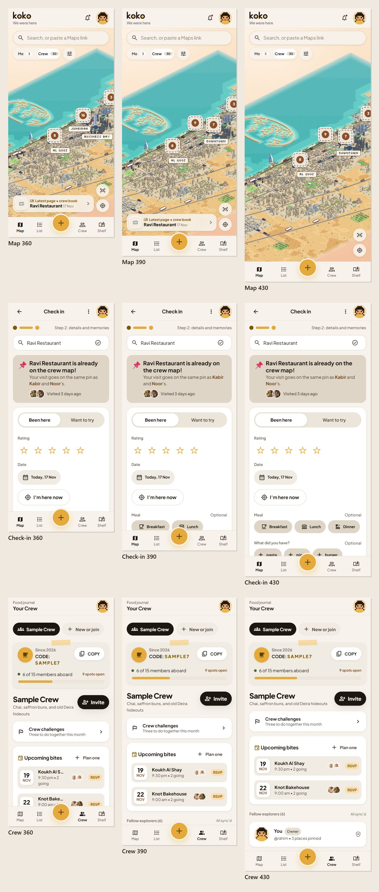

### Dark mode ([14-dark](koko-audit/14-dark.jpg))

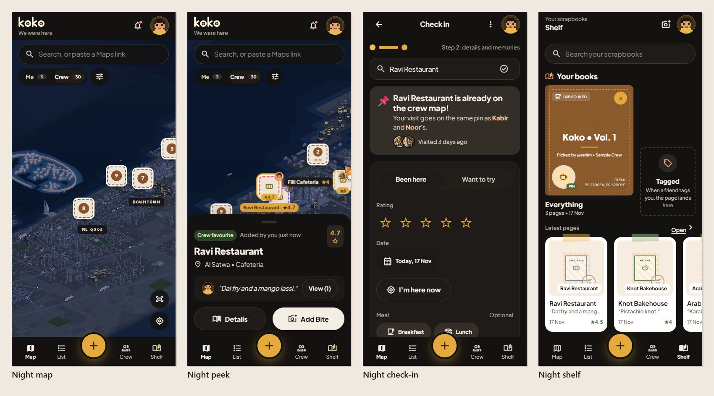
- **The night map is the best dark mode in the app.** [O] The UI flips cleanly: primary buttons go cream, paper stays paper. [C]
- **Issues:**
  - the warm-vs-cool mismatch next to the map
  - near-invisible selected segments
  - 1.28:1 switch tracks
  - the map at the wide zoom is so dark that the coastline is the only landmark [C, O]

---

## D. Trend research

About 40 separate searches across type, colour, motion, layout and density, navigation, iconography, micro-interactions and haptics, dark mode, pixel and retro, award winners, and shipped food, social, travel, journaling and map apps. Load-bearing claims were opened and checked at the source. Where a page couldn't be read, the row says so.

### Trends considered

Column 3 is what the source says (**evidence**). Column 4 is my verdict against the five tests: fits Koko, sits with the pixel map, survives to 2028, works in a PWA and Capacitor on mid-range phones, serves an objective. That column is **opinion**.

| # | Trend | What the source says (evidence) | Verdict and why (opinion) |
|---|---|---|---|
| 1 | Liquid Glass / translucent chrome | Apple kept Liquid Glass in iOS 27 but added a transparency slider "from ultra clear to fully tinted" after feedback. [MacRumors, Jun 2026](https://www.macrumors.com/2026/06/10/how-liquid-glass-is-changing-in-ios-27/) Readability complaints at launch. [MacRumors, Sep 2025](https://www.macrumors.com/2025/09/17/ios-26-liquid-glass-critiques/) | **Skip.** Blur over pixel art destroys the hard pixels, costs GPU on mid-range Android WebViews, and reads as imitation in a PWA. |
| 2 | Glassmorphism in general | The most-mentioned *fading* trend in a 100-designer survey. [Lyssna](https://www.lyssna.com/blog/ux-design-trends/) | **Skip.** Remove the existing blur buttons. |
| 3 | Bento grids | "Now the default, not the exception", i.e. saturated. [Netguru](https://www.netguru.com/blog/top-web-design-trends) | **Skip.** A map-first app has no dashboard to tile. |
| 4 | Soft 3D, dimensional icons | Airbnb's 2025 redesign moved to 3D icons ("I didn't want it to feel like a database"). [It's Nice That](https://www.itsnicethat.com/articles/airbnb-app-redesign-140525), [Bloomberg](https://www.bloomberg.com/news/articles/2025-06-13/apple-airbnb-ditch-flat-app-icons-for-new-3d-ui-design) | **Skip.** A second rendering style next to the pixel city is pastiche squared. |
| 5 | Emphasis on key actions (M3 Expressive) | Google: 46 studies, 18,000+ participants. Key elements spotted "up to four times faster", and older users as fast as younger ones. [Google Design](https://design.google/library/expressive-material-design-google-research) (verified) | **Adopt the principle**, not the Material look: one emphasised action per screen, bigger and in a distinct shape and colour. Serves objective 1. |
| 6 | Springs and shape morphing | M3 Expressive motion is springs plus shape morphing. [Android Developers](https://developer.android.com/design/ui/wear/guides/get-started) CSS `linear()` can express springs (Chrome 113, Safari 17.2+). [Chrome docs](https://developer.chrome.com/docs/css-ui/css-linear-easing-function) In released Safari, `linear()` animations run on the main thread. [WebKit bug 312407](https://bugs.webkit.org/show_bug.cgi?id=312407) (verified) | **Adapt.** Springs for sheets, pins and stamps, with a cubic-bezier fallback, transform and opacity only. Skip shape morphing. |
| 7 | Search at the bottom, for reach | Apple's HIG prefers bottom search, and a bottom search field "animates up over the keyboard, optimizing for reachability". [HIG search fields](https://developer.apple.com/design/human-interface-guidelines/search-fields), [WWDC25 session 284](https://developer.apple.com/videos/play/wwdc2025/284/) | **Adopt.** Serves objective 2 directly. |
| 8 | Thumb-zone ergonomics | Most one-handed use is the thumb, and accuracy drops toward the top and corners. [Hoober, UXmatters](https://www.uxmatters.com/mt/archives/2013/02/how-do-users-really-hold-mobile-devices.php), [Smashing](https://www.smashingmagazine.com/2016/09/the-thumb-zone-designing-for-mobile-users/) | **Adopt.** Old research, still the basis for 2026 platform choices. |
| 9 | Map plus resizable sheet (detents) | Sheets rest at medium and large detents, plus custom ones. [HIG sheets](https://developer.apple.com/design/human-interface-guidelines/sheets) | **Adopt.** The map stays the hero while lists and cards live in one sheet. |
| 10 | Tab bars that hide on scroll, search as a separate tab bubble | Users disliked hiding bars, and Safari added an off switch. Critics say the search "tab" looks like a button. [Ryan Ashcraft](https://ryanashcraft.com/ios-26-tab-bar-beef) | **Skip.** Keep a stable bar. Never hide it while scrolling. |
| 11 | Variable fonts as the baseline | "By 2026, variable fonts aren't a trend anymore". [Muzli](https://muz.li/blog/best-free-variable-fonts-for-ui-and-web-design-2026/) Expressive yet restrained type in product UI. [Creative Bloq](https://www.creativebloq.com/design/fonts-typography/breaking-rules-and-bringing-joy-top-typography-trends-for-2026) | **Adopt.** One variable file for display and UI. |
| 12 | Rounded axes in open type (Google Sans Flex) | Released under SIL OFL 1.1 in November 2025, with a rounded-terminals axis (ROND). [9to5Google](https://9to5google.com/2025/11/18/google-sans-flex-font-available/), [Fontsource](https://fontsource.org/fonts/google-sans-flex/about) | **Adopt.** ROND lets headings echo the ring-and-dot wordmark while UI text stays crisp. |
| 13 | Pixel type as accent, clean type for reading | Nothing dialled dot-matrix type back to accent areas for legibility, moving body text to Geist. [Android Authority](https://androidauthority.com/nothing-os-5-0-3702682) (via search summary; Nothing's own post didn't load). Vercel's Geist Pixel, "bitmap-inspired", five variants, Feb 2026. [Vercel](https://vercel.com/blog/introducing-geist-pixel) (verified), OFL per [repo](https://github.com/vercel/geist-font). Balatro players built a mod to swap the pixel font for a smooth one. [Readabletro](https://github.com/bladeSk/readabletro) | **Adopt.** Pixel type only for the map's own voice (area labels, pin counts, critter names). Everything you read in a sentence uses the sans. |
| 14 | Modular pixel UI kits (pixel buttons and cards) | "Pixel UI systems are becoming a real category". [Design Project](https://www.newsletter.designproject.io/p/design-for-nostalgia-why-pixel-art-and-retro-ui-are-dominating-2025) | **Skip for chrome, adapt for map overlays only.** Pixel buttons everywhere would be pastiche, and accessibility "decides where these styles fit". [Setproduct](https://setproduct.com/blog/retro-brutalist-ui-design-2026) |
| 15 | Hard shadows and borders (neo-brutalist accents) | Recommended to skip where legibility matters. [Netguru](https://www.netguru.com/blog/top-web-design-trends) | **Adapt narrowly.** 1 px ink outline plus a 2 px hard shadow, cast down-left like the city's own shadows, on map overlays and stickers only. |
| 16 | Dithering and 1-bit textures | A "dithering renaissance" is claimed (single promotional source). [ohdith](https://ohdith.pages.dev/blog/the-dithering-renaissance) | **Adapt narrowly.** Night fog edges, empty states, the monthly drop. Never on text. Weak evidence. |
| 17 | Anti-AI craft: texture, warmth, a human hand | "Personality, warmth and unmistakably human design" (standfirst verified). [Creative Bloq, Dec 2025](https://www.creativebloq.com/design/graphic-design/texture-warmth-and-tactile-rebellion-the-big-graphic-design-trends-for-2026) | **Adopt, on scrapbook surfaces.** Paper, tape and handwriting belong to memories, not to settings. |
| 18 | Digital scrapbooking: collage, washi tape, stickers | Named as a 2026 aesthetic. [Pixlr](https://pixlr.com/blog/handmade-scrapbooked-and-dopamine-bright-the-design-trend-bringing-back-the-human-touch/) Sticker-journal apps in 2026, e.g. [daplit](https://apps.apple.com/app/6758196739) | **Adopt (already core).** Refine rather than add. |
| 19 | Dopamine maximalism, saturated palettes | Same Pixlr piece. | **Skip for chrome.** Fine inside stickers. |
| 20 | Calm near-white neutrals | Pantone 2026 is Cloud Dancer, "the first white", with a split reaction. [Wallpaper](https://www.wallpaper.com/design-interiors/pantone-colour-of-the-year-2026-cloud-dancer-white) | **Adapt.** Keep warm paper. Sheets get a cleaner "raised" white so content sits forward. |
| 21 | Luminous Blue (2027 colour) | WGSN and Coloro Colour of the Year 2027. [FashionUnited](https://fashionunited.uk/news/fashion/wgsn-and-coloro-name-luminous-blue-colour-of-the-year-2027/2025042981347) (WGSN page refused access) | **Adapt.** A teal pulled from the map's own sea becomes the single functional colour for "shared with crew". Forecast-aligned and native to the map. |
| 22 | Dark mode as an expectation, not pure black | Avoid #000 and design dark separately. [Uxcel](https://uxcel.com/blog/12-principles-of-dark-mode-design-627), [Atmos](https://atmos.style/blog/dark-mode-ui-best-practices) | **Adopt.** Refine: map-aware night chrome. |
| 23 | Micro-interactions and motion | 23% of designers expect major impact; "simpler, performance-focused UI" is rising. [Lyssna](https://www.lyssna.com/blog/ux-design-trends/) | **Adopt** where it confirms an action. |
| 24 | Web haptics | Safari has no `navigator.vibrate()`. A `<input switch>` trick fires the Taptic Engine, and one library says Apple patched it in iOS 26.5 (unverified). [ios-haptics](https://npmjs.com/package/ios-haptics), [WebKit 285120](https://bugs.webkit.org/show_bug.cgi?id=285120) | **Adapt.** Capacitor Haptics on Android. On iOS, treat any trick as optional enhancement and never rely on it. |
| 25 | View transitions | Same-document transitions are Baseline (Oct 2025); cross-document in Safari 18.2+. [web.dev](https://web.dev/blog/same-document-view-transitions-are-now-baseline-newly-available), [caniuse](https://caniuse.com/cross-document-view-transitions) | **Adopt.** Shared-element continuity from pin to card to place page. |
| 26 | Scroll-driven animations | Threaded in Safari 26.4. [WebKit 312407](https://bugs.webkit.org/show_bug.cgi?id=312407) | **Skip.** Nothing in Koko needs them. |
| 27 | Squircles (`corner-shape`) | Chrome and Edge 139 only. [MDN](https://developer.mozilla.org/docs/Web/CSS/Reference/Properties/corner-shape), [Smashing](https://www.smashingmagazine.com/2026/03/beyond-border-radius-css-corner-shape-property-ui/) | **Skip** (inconsistent across platforms). |
| 28 | AI as collaborator and conversational UI | 73% expect AI-as-collaborator impact. [Lyssna](https://www.lyssna.com/blog/ux-design-trends/) | **Skip in the UI.** Keep AI invisible (caption parsing, photo tags). A chat box would undercut "your own people only". |
| 29 | Privacy-first patterns | 18% expect major impact. [Lyssna](https://www.lyssna.com/blog/ux-design-trends/) Instagram's Friend Map backlash was about confusion over what was shared. [NBC News](https://www.nbcnews.com/tech/tech-news/instagram-maps-feature-raises-privacy-concerns-some-users-rcna223706), [PetaPixel](https://petapixel.com/2025/08/07/psa-youre-visible-on-instagrams-new-friend-map-without-sharing-your-location) | **Adopt.** Make visibility an ambient, consistent state on every surface. Serves objective 5. |
| 30 | Cozy companion collectables | Google Play Best App 2025, Focus Friend: cosmetic rewards, not scores. [Google](https://blog.google/products/google-play/best-apps-games-2025/), [Deconstructor of Fun](https://www.deconstructoroffun.com/blog/2026/2/19/golden-mechanics-focus-friend-9mg74) | **Adapt.** Critters as companions (the favourite critter on your pins). No streaks, no goals. Serves objective 6. |
| 31 | Tactile reveals | Pokémon TCG Pocket's "tactile touches, such as opening booster packs". [Google Play Best of 2025](https://blog.google/products/google-play/best-apps-games-2025/) | **Adapt** for the critter catch and the monthly drop (already close). |
| 32 | Playful living social maps | Zenly was "the most playful and iconic map app", with animated cars, boats and rubber ducks. [TechCrunch](https://techcrunch.com/2022/04/22/how-zenly-made-social-maps-cool-again-and-whats-next) | **Adopt (already true).** Protect the map's life at the right zoom levels. |
| 33 | Periodic friend recaps | Retro's week-by-week journal format, which Google Photos copied. [TechCrunch](https://techcrunch.com/2024/07/11/photo-sharing-startup-retro-spots-google-photos-copying-its-idea-and-design/) | **Adopt (already built** as the monthly drop). |
| 34 | Diary framing over reviews | Letterboxd logs a film as a dated diary entry; reviews can come later. [Letterboxd FAQ](https://letterboxd.com/about/faq/) | **Adopt.** Log first, details later. Directly shapes the check-in redesign. |
| 35 | Pairwise ranking (Beli) | Users dislike forced comparisons between unlike places. [Pratt IxD critique, 2026](https://ixd.prattsi.org/2026/09/a-design-critique-of-beli-restaurant-discovery-and-social-platform/) | **Skip.** Half-star ratings are faster at the table. |
| 36 | Playful self-expression for friend groups | Partiful's humour and customisation; Google Play Best App 2024. [NBC](https://www.nbcnewyork.com/news/business/money-report/meet-partiful-the-gen-z-party-planning-staple-thats-taking-on-apple/6231135/) | **Adapt** for share cards and spreads only. Chrome stays quiet. |
| 37 | Kinetic and oversized type | Large expressive headlines are common, with performance caveats. [Creative Bloq type trends](https://www.creativebloq.com/design/fonts-typography/breaking-rules-and-bringing-joy-top-typography-trends-for-2026) | **Adapt.** Only the monthly drop and empty states. |

Award and featured context used to sanity-check the list:
- [Apple Design Awards 2026](https://www.apple.com/newsroom/2026/06/apple-reveals-winners-of-the-2026-apple-design-awards/). Interaction went to Moonlitt and Visuals to Tide Guide: focused, single-purpose apps.
- [App Store Awards 2025](https://developer.apple.com/app-store/app-store-awards-2025). Tiimo, "color-coded timelines".
- [Google Play Best of 2025](https://blog.google/products/google-play/best-apps-games-2025/). Focus Friend; Pokémon TCG Pocket for tactile feel.
- Shipped place-saving apps: [Corner](https://apps.apple.com/app/id1668282277), Mapstr, Beli.

### Recommended direction: five trends, and where they show up

1. **Thumb-first map with one sheet** (trends 7, 8, 9; evidence from HIG, WWDC25, Hoober).
   - **Map:** full-bleed, with no wordmark header. Bell and avatar become small floating buttons top-right.
   - **One bottom sheet** with three detents: *peek* (search field plus a scope row), *half* (results, the place card, the old List), *full* (the place page).
   - **The search field lives in the sheet at the bottom** and rises above the keyboard. List stops being a tab.
2. **One emphasised action per screen** (trend 5; Google's research).
   - **Check-in** is the dominant control on the map and on every place.
   - **The place page** has one filled button.
   - **The check-in sheet** ends with the save buttons themselves: `[ 🔒 Just me ]` `[ Save to Karak Crew ]`. Choosing who *is* saving: one tap, still explicit.
3. **Pixel for the city, paper for memories, ink for the rest** (trends 13, 14, 15, 17; Nothing, Geist Pixel, Readabletro, Creative Bloq).
   - **Map overlays** (pins, area labels, map buttons) are pixel-snapped, with 1 px ink outlines and hard down-left shadows, in Geist Pixel.
   - **Scrapbook surfaces** keep paper, tape and handwriting.
   - **Everything else** (sheets, settings, crew, forms) is quiet ink on paper in one variable sans, with no textures, emoji or dashed borders.
4. **Tactile feedback with restraint** (trends 6, 23, 24, 25, 31; Chrome, WebKit, Lyssna).
   - **Springs** on sheets and pin drops.
   - **View transitions** from pin to card to page.
   - **Haptic ticks** on stars and save (Capacitor on Android).
   - **The stamp slam and page curl stay.**
   - **Reduced motion** swaps everything for 150 ms cross-fades and a still map.
5. **Privacy as a visible state** (trends 21, 29; Lyssna, Instagram Map backlash).
   - **"Shared with crew" is always sea-teal plus the crew icon.** "Just me" is always ink plus a lock.
   - **The same pair** appears on the save buttons, pins (a lock badge), place pages, pages in the book, the share sheet and the bell.

### Evidence versus opinion
- **Evidence (sourced):**
  - Google's emphasis research
  - Apple's guidance on bottom search and sheets
  - the Liquid Glass readability retreat
  - glassmorphism's decline in the Lyssna survey
  - variable fonts as baseline
  - Google Sans Flex licence and axes
  - Geist Pixel's release
  - Safari `linear()` limits
  - view transitions support
  - iOS web haptics limits
  - Android 16 edge-to-edge
  - WGSN 2027 colour (secondary source)
  - Instagram Map confusion
  - Focus Friend's cosmetic rewards
- **Opinion (mine):**
  - which trends fit Koko
  - "pixel for the city, paper for memories"
  - choosing who as the save action
  - teal from the map's sea as the shared colour
  - per-author handwriting
  - the IA options
  - every "Skip"

### Proposed type system

| Role | Font | Settings | Sizes (px / line height) | Licence | First-load cost | What it does for the brand |
|---|---|---|---|---|---|---|
| Display | **Google Sans Flex** | wght 700–760, **ROND 100**, tracking −1% | 32/38 screen titles and place names; 24/30 sheet titles; 20/26 section heads | SIL OFL 1.1 | Shared with UI (one file) | Fully rounded terminals rhyme with the ring-and-dot "koko" without imitating it. Heavy but friendly. |
| UI text | **Google Sans Flex** | wght 420 body, 560 labels, 650 buttons, **ROND 0–20**, tabular figures for ratings and counts | 16/24 body; 15/22 secondary; 13/18 labels; 12/16 timestamps only (floor) | SIL OFL 1.1 | **69 KB** (wght + ROND, Latin; measured). Adding opsz takes it to 198 KB, so skip opsz. | One family for every word you read. Crisp at small sizes, warm at large ones. |
| Pixel | **Geist Pixel** (Square) | Whole-pixel sizes only | 12 and 16 (area labels, pin counts, critter names, sticker labels) | SIL OFL 1.1 ([repo](https://github.com/vercel/geist-font)) | **16 KB** | The map's voice. It replaces Silkscreen, which is drawn at a non-integer 10 px today and is caps-only, with a modern bitmap face that has lowercase. |
| Mono (paper only) | **Space Mono** (keep) | 400 and 700 | Inside the 360×600 page canvas: 10–12 | SIL OFL 1.1 | 18 KB, **load lazily** with the Shelf | Postmarks, dates and coordinates: the stationery voice the pages already have. |
| Handwriting (notes on pages) | **Shantell Sans** | wght 450, INFM 40–70, BNCE 0–30 | 18/24 on the page canvas | SIL OFL 1.1 | 77 KB, lazy | Replaces Caveat (72 KB, the web's default "handwriting"). Its Informality and Bounce axes can be **seeded per author**, so each friend's notes look a little different. [O] [source](https://material.io/blog/shantell-martin-variable-font) |
| Icons | **Material Symbols Rounded**, subset to the 142 names in use | FILL 0–1, wght 400, opsz 24 | 20/24 | Apache 2.0 | **22 KB** (measured with `icon_names=`) vs **2,321 KB** today | Rounded strokes match the type. Cuts 73% of first-load weight. |

Loading rules:
- **Self-host every font on the same origin**, so the service worker caches them and the APK bundles them.
- **Preload only Google Sans Flex.** Use `font-display: swap` for text; icons may use `block` because they are tiny and preloaded.
- **First-paint budget:** about 107 KB of fonts, against 2,356 KB measured today.
- **Licences:** OFL allows bundling in closed-source, commercial apps; you can't sell the fonts on their own. Before shipping self-made subsets, check each font's Reserved Font Name clause, or use the publisher's own subset files. Not legal advice.

**Type options for decision D2:**

| Option | What it is | Verdict |
|---|---|---|
| **(A) Recommended** | The system above. | Most brand coherence per KB. |
| **(B) Legibility-first** | Atkinson Hyperlegible Next for UI (33 KB, OFL, seven weights and a Mono sibling). [source](https://christiantietze.de/posts/2025/02/atkinson-hyperlegible-font-next-mono/) | Best for sunlight and low vision. Less warmth, and no tie to the wordmark. |
| **(C) Minimum change** | Keep Plus Jakarta Sans (26 KB). Swap Silkscreen for Geist Pixel and Caveat for Shantell. Subset the icons. | Cheapest. Fixes performance, not the dated feel. |

### Proposed colour

Map colours, sampled from live:
- day sea `#56b8b9`
- day sand `#eed4ac` and `#e1c6a0`
- night sea `#0a162b`
- night land `#262a34`

| Token | Day | Night | Use | Contrast (computed) |
|---|---|---|---|---|
| paper | `#F7F3EC` | `#141210` (map overlays: `#12151C`) | App background | ink on paper 16.0:1 both themes |
| raised | `#FFFDF8` | `#1F1B18` | Sheets, cards | ink-3 on raised 5.86:1 / 6.89:1 |
| ink | `#1D1712` | `#F3EDE4` | Text, primary buttons, pin outlines | 16:1 |
| ink-3 | `#6C6258` | `#ADA397` | Secondary text | 5.39:1 / 7.53:1 |
| line | `#8B8176` | `#7D7266` | Input borders, switch tracks, chip outlines (fixes 1.4.11) | 3.45:1 / 3.98:1 |
| gold | `#E8A92B` (brand kit) | `#F0B955` | Check-in, selected tab, rating fill. **Always with ink content or a 2 px ink edge**, because gold on paper is 1.87:1. | ink on gold 8.57:1 / 10.48:1 |
| gold-ink | `#7E5700` | `#F0B955` | Gold text | 5.84:1 / 10.48:1 |
| crew (shared) | `#0E6F78` | `#6CCFD4` | "Shared with crew" text, icons, chips, pin badges | 5.33:1 on paper / 10.25:1 |
| just-me | ink plus lock | ink plus lock | "Just me" | as ink |
| danger | `#B3261E` | `#FFB4AB` | Destructive text, never a pink slab | 5.91:1 / 11.01:1 |
| owner colours | the existing 12 | same | Pin bodies (not thin rings) | coral ring on sand is only 2.08:1, so give it a fill plus an ink outline |

**How the palette sits next to the map.** [O]
- **Day:** paper and sand are one family, which is calm but makes overlays vanish. Pins and labels separate from the map by **ink outlines and hard shadows** (12.4:1 against sand), not by colour.
- **Night:** chrome that floats over the map (the sheet, map buttons) moves to a cooler `#12151C` so it belongs to the navy city. Full-screen pages keep the warm charcoal.
- **Teal:** taken straight from the sea, so the one functional colour feels native to the map.

### Components (the system, not just the look)

**Buttons.**
- **Three levels.** Primary is an ink pill, 52 px, at most one per view. Secondary is raised paper with a 1.5 px `line` border. Tertiary is text only.
- **Check-in is the only gold button in the app.**
- **Destructive is red text.** Pressed state: scale 0.97 on a spring.
- **One verb per action,** used everywhere: Check in · Save to try · Plan · Share.

**Chips.**
- **36 px tall visually, 44 px hit area.** Selected is an ink fill with paper text.
- **Kind chips** show the kind's icon in its colour with ink text. No saturated fills.
- **"Who" chips** use teal (crew) or ink plus lock (just me), and nothing else.

**Cards.**
- **Only for content objects:** a place, a page, a person, a plan. Never card-in-card.
- **Settings, menus and member lists are grouped lists** on paper with hairline separators. The whole row is the tap target, toggles included.

**Sheets.** One component with detents (peek about 132 px, half 50%, full 92%), a 36×5 grabber, 24 px top radius and spring settling. It replaces most pushed screens. Full-screen stays only for sign-in, the camera, the photo viewer and the book.

**Inputs.**
- **52 px tall, 1.5 px `line` border.**
- **Focus:** 2 px ink plus a gold outer glow.
- **Labels above, always.** That fixes `#evWhen`.

**Navigation.** See layout below and decision D1.

**Pins (map layer, pixel-snapped).**
- **Body:** the owner's colour as a solid body, with a 1 px ink outline and a 2 px hard shadow down-left.
- **Content:** the kind glyph in paper.
- **Badges:** a face (Crew view, mid and near zoom), a lock (Just me), a TRY ribbon in gold with ink text.
- **Clusters:** an ink disc with a pixel count plus up to three owner-colour face dots, so faces show even at the wide zoom.
- **Selected:** a gold ring with a 2 px lift.

**Stamps.** The postage-stamp metaphor stays, made of pixels. Perforations are drawn as pixel notches on the map pin's edge. Rubber stamps (rating, VISITED) remain scrapbook-only.

### Motion and feedback

| Moves | Duration and curve | Reduced motion |
|---|---|---|
| Sheet detents, pin drop on save | Spring (≈ stiffness 400, damping 30) via `linear()` with a bezier fallback | Cross-fade, 150 ms |
| Map fly-to | 600–900 ms ease-out, paused cars | Jump cut |
| Pin → card → place page | View transition (shared element) | Cross-fade |
| Stamp slam, tape-in, page curl, photo develop | Keep as built | Already handled |
| Stars, Save, toggles | 120 ms scale plus a haptic tick (Android), none on iOS web | No scale |

**Doesn't move:** text, lists (no staggered entrances), chrome (no parallax), and no idle loops in the UI. The map's ambient life is the only always-on motion, and it stops below mid zoom for cars, matching the spec.

### Layout and navigation

The current bottom bar (Map · List · ⊕ · Crew · Shelf) gives a tab to a duplicate (List) and sends ⊕ through a menu. Search is out of reach at the top. Three options:

| Option | Layout | Verdict |
|---|---|---|
| **(A) Recommended: Map + sheet** | Tabs: **Map · ⊕ Check in · Scrapbook**. Crew moves to an avatar menu, plus a "Crew" scope inside the sheet. The map's sheet holds search, results, filters as chips, the place card and the old List. ⊕ goes straight into check-in, and links are pasted there. | Fewest surfaces, everything in thumb reach, map always visible. Large effort. |
| **(B) Keep five slots, fix the jobs** | Map · **Search** · ⊕ · Crew · Shelf. Search is a full-screen bottom-anchored search with scopes; List is dropped. | Medium effort, a familiar pattern. The map is still covered by chrome. |
| **(C) Map-only home** | No tab bar. A map with a sheet, a big ⊕, and a scrapbook shelf as the sheet's full detent. | The boldest. Crew and settings get buried, and it's hard to explain to testers. |

Thumb reach:
- **Bottom 40%:** check-in, search, save, rating.
- **Middle:** content.
- **Top:** the bell, the avatar and Back only.

### Pixel craft: rules for the chrome around the city

- **Snap map overlays to whole device pixels.** Pixel fonts at 12 or 16 px, art at integer scales, which the map already does for zoom.
- **Hard shadows go down-left, as the city's do** (light from the upper right, `mapraster.js`). One rule for every overlay: 2 px offset, no blur, 28% ink.
- **Pixel icons only for map controls** (fit, locate, compass), drawn on a 16 px grid at 2×. All other icons stay vector and rounded.
- **No blur, gradient or glass over the map.** Separation comes from ink outlines.
- **Dithering only where the map already fades:** fog edges and night transitions. Never behind text.
- **Deliberately not pixel:** body text, forms, sheets, settings, photos, and the scrapbook paper, which is analogue on purpose.

---

## E. What to cut

| Cut | Where | Why | Label |
|---|---|---|---|
| **List tab** (and its own search, Me/Crew toggle, chips and sort) | `app.js:337–409`; on map-art also `placesview.js` | Duplicates the map and the main search. Its job belongs in the map sheet's half detent. | C (duplication), O (cut) |
| **The + menu sheet** | `app.js:457–466` | One extra tap on every log. Links already work in search. | C |
| **"Scrapbook Roll Capacity" bar on every log** | `place.js:402` | Shows "0 / 300". Keep only the "full" alert, from 280. | C, O |
| **Dead "⋮" on check-in step 1** | `place.js:340,365` | Only shows a toast. | C |
| **Step dots and "Step 1/2" text on check-in** | `place.js:341` | Two-step flows don't need a progress meter. | O |
| **Profile button on every pushed screen and flow** | `topbar()` | Competes with Back. The avatar belongs on the map only. | O |
| **"…is already on the crew map!" banner (160 px) and 📌 emoji** | `place.js:379–382` | Becomes one line: "Kabir and Noor have been · 3 days ago". | C, O |
| **Ten starter dish chips** | `place.js:494–502` | Show your own past tags only; the starter list goes. | O |
| **Filter sheet:** "1. View mode", numbering, Visit status cards with fake "★★★★☆ Rated", "To try ribbon" tag, "Privacy scope" triple, "Colour explored areas" | `app.js:281–330` | Duplicate toggle and decoration. Privacy collapses to one "Just me only" chip. Explored areas moves to Settings → Map. | C, O |
| **Crew screen:** capacity bar, "members aboard", "spots open", "Since 2026", "Fellow explorers", "Food journal", uppercase CODE/COPY, fixed "All sync'd" | `crew.js:140–160` | Gamified or fake status. | C |
| **Crew challenges and personal goals** (screen, profile card, Crew tab row) | `social.js`, `profile.js` | Gamification beyond stickers and critters. | C (exists), O (cut) |
| **"3/51 areas" and other progress counters** | Profile stats | Counters toward completion are what removing points was meant to end. | O |
| **Onboarding steps 3 and 4** (explainers) | `onboarding.js:302–339` | Their content moves to the first save and the first sticker. | O |
| **Handle-step fake feed preview** | `onboarding.js` handle step | Noise on a five-second step. | O |
| **The 16-step spotlight guide** | `tour.js` | Becomes three hints: search, save, your stamp. Everything else is discoverable or contextual. | O |
| **"We were here" tagline in the map header** | `index.html` header | A brand line, not UI. Keep it for the welcome screen, share cards and the cover. | O |
| **The "Latest page" strip permanently on the map** | `memories.js` | Show only "On this day" or a just-taped page. Otherwise the map stays clear. | O |
| **Donation card at the top of Settings** | `profile.js` | Move it to About. | O |
| **"Preview with a sample crew" in the main Settings list** | `profile.js` | A tester tool: put it under About → For testers. | O |
| **Uppercase mono tab labels in the sticker tray; "DXB SOUK ED.", "PIN" and coordinates on the book cover** | `decorate.js`, `book.js` | Break the spec's sentence-case rule and add 4–9 px text. | C |
| **"Add Bite", "Plan a bite", "Upcoming bites"** | `app.js:213`, `place.js:112`, `crew.js` | Old brand. Use Check in and Plan. | C |
| **"Works with" pseudo-chips on Add from link** | `share.js` | They look tappable and aren't. | C |
| **Blur ("glass") behind map buttons** | `styles.css`, 7 `backdrop-filter` | Fights the pixel art and costs GPU. | C, O |
| **Material Symbols Outlined variable font, as loaded** | `index.html:39` | 2,321 KB, `display=block`. | C |

---

## F. Prioritised improvements

Effort: **S** about a day or less, **M** a few days, **L** a week or more. Risk is the chance of breaking existing behaviour.

### Tier 1: quick wins

| # | Change | Why (journey / objective) | Files | Effort | Risk |
|---|---|---|---|---|---|
| Q1 | Give the welcome screen the `cover` class so the tab bar hides | A1 · objective 5 (signed-out access) | `onboarding.js:21` | S | Low. Check the invite welcome still shows the crew card. |
| Q2 | Replace the fixed "All sync'd" with real state ("All saved" / "3 changes waiting" / "Offline") from `C.pending()` and `navigator.onLine` | A2, A11 · objective 5 | `crew.js:150`, `cloud.js` | S | Low |
| Q3 | Make ⊕ open check-in directly. Its search accepts links ("Paste a link" row). Move the Inbox to the bell. | A4, A5 · objective 1 (−1 tap per log) | `app.js:457`, `place.js`, `share.js` | S | Medium. The Inbox entry needs a new home first. |
| Q4 | Remove the dead "⋮". Use "Change" (text) instead of the check-circle icon. | A4 | `place.js:340,365,378` | S | Low |
| Q5 | Move "Who's this for?" to the top of step 2, directly under the place | A4 · objective 1 | `place.js:404` | S | Low (the tour's spotlight order changes too) |
| Q6 | Drop the capacity bar until 280. Drop the starter dish chips. | A4 | `place.js:402,494` | S | Low |
| Q7 | Close the peek when search opens. Raise search results above the peek. | A3, A7 · objective 2 | `searchui.js`, `app.js` | S | Low |
| Q8 | Load icons subset with `icon_names=` (22 KB) as an interim, Rounded style, `display=block` kept | Objective 3 (first load) | `index.html:39` | S | Medium. Any icon name missing from the list renders as text, so add a test that greps `icon('…')` names. |
| Q9 | Fix contrast: count badges, the slate chip, input borders and switch tracks to `line` (3:1), star outlines, dark selected segments. Label `#evWhen`. | Accessibility | `styles.css` tokens, `events.js` | S | Low (the a11y suite in CI catches regressions) |
| Q10 | Targets: Me/Crew to 44 px. Toggle rows tappable end-to-end. Map labels get a 44 px hit area. | Accessibility | `styles.css`, `profile.js`, `map.js` labels | S | Low |
| Q11 | One name per action: "Add Bite" → Check in, "Plan a bite" → Plan. Fix 14 vs 15. Sentence-case the mono labels. Remove 📌 📍. Retire "Fellow explorers", "aboard", "Food journal", "Scrapbook passport". | Consistency | `app.js`, `place.js`, `crew.js`, `profile.js`, `decorate.js` | S | Low (e2e selectors use ids, not copy, but check `scenarios.mjs` text matches) |
| Q12 | Open books at the newest page (or the last read), keeping "Page n of N" | A8 · objective 4 | `bookview.js` | S | Low |
| Q13 | One progress indicator in onboarding (keep the bars) | A1 | `onboarding.js` | S | Low |
| Q14 | Settings: move the donation card to About and "Sample crew" to About → For testers | A10 | `profile.js` | S | Low |
| Q15 | Remove the blur from map buttons and give them an ink outline and hard shadow | A3 · objective 3 | `styles.css` | S | Low |

### Tier 2: core experience upgrades

| # | Change | Why | Files | Effort | Risk |
|---|---|---|---|---|---|
| C1 | **Check-in v2** (options below) | A4 · objective 1 | `place.js` (split into `checkin.js`), `tour.js`, `tapein.js` | M–L | Medium. The tour, Import Roll ("Next" for groups) and the tagged "Add to their visit" path all enter this flow. |
| C2 | **One search component**: same results and ranking everywhere, scopes (All · Been · Want to try · People · Pages), bottom-anchored on the map; drop List search | A7 · objective 2 | `searchui.js`, `search.js`, `book.js` (shelf search), `app.js` | M | Medium (shelf "open page" vs map "fly to" behaviours must stay) |
| C3 | **Component and token system v2** plus type, colour and icon rollout (D sections): self-host fonts, grouped lists, chips, sheets, inputs; remove the 108 inline styles | All · objectives 3, 5 | `styles.css`, `ui.js`, every screen file | L (spread over screens) | Medium. Visual regressions, so extend `spacing.mjs` and `a11y.mjs` with screenshot diffs. |
| C4 | **Pins v2**: owner-colour bodies, ink outline, hard shadow, faces on clusters, pixel counts in Geist Pixel; aim for ≥3:1 against sand | A3 · objective 3 | `ui.js` `stampHTML`, `styles.css` stamp rules, `map.js` | M | Medium (performance with 500 places, `?synthetic=500`) |
| C5 | **Onboarding trim**: sign in → handle + avatar on one screen → crew (skippable) → map. Explainers become contextual. Guide down to 3 hints. | A1 · objectives 1, 5 | `onboarding.js`, `crew.js`, `tour.js` | M | Medium (tour tests, invite path) |
| C6 | **Place page hierarchy**: one primary (Check in), a secondary row (Save to try · Plan · Directions), overflow for Send, Show on map and Edit; reviews as one list | A3, A4, A6 | `place.js:71–141` | M | Low–medium |
| C7 | **Filter as chips in the sheet** (people, kinds, meal, been / want, Just me only); no numbering; live result count | A3 | `app.js:281–330` | M | Low |
| C8 | **Offline and sync UX**: a small status pill (offline / n waiting), "waiting to send" on items, a toast naming the conflict; service worker stale-while-revalidate for versioned files | A11 · objective 5 | `cloud.js`, `store.js`, `sw.js`, `ui.js` | M | Medium (cache invalidation: version the files) |
| C9 | **Profile and Settings restructure**: grouped lists, profile = avatar, critters, stickers, your month; cut goals | A9, A10 · objective 6 | `profile.js`, `social.js` | M | Low (goal data can stay in the DB) |
| C10 | **Motion and haptics layer**: springs, view transitions pin → card → page, haptics map | Objectives 3, 4 | `ui.js`, `map.js`, `feel.js`, `haptics.js` | M | Low (progressive enhancement) |

**C1 options: the check-in flow (decision D4 and its shape).**

| Option | How it works | Taps for a known place | Verdict |
|---|---|---|---|
| **(A) Recommended: one sheet, details folded** | ⊕ opens a sheet over the map: search → tap a place → the same sheet shows **stars, a big photo button, and the save buttons** (`[🔒 Just me]` `[Save to Karak Crew ▾]`). "Add details" expands meal, dish, notes, tags and date. Saving is the who-choice. | 4: ⊕ → place → star → save-to-crew | Keeps the explicit privacy choice, halves the taps, photos up front. Letterboxd's diary framing: log now, details later. |
| (B) Stepper | Place → rating → photos → who → done, one per screen | 5–6 | Clear for first-timers, slower for regulars. |
| (C) Camera-first | ⊕ opens the camera; the photo's time and place suggest the venue | 3–4 with a photo | Delightful at the table. Depends on GPS in photos, which browsers often strip (spec, Import Roll). Treat it as a new feature, **out of scope for now**; at most a later shortcut inside (A). |

### Tier 3: strategic redesigns

| # | Change | Why | Files | Effort | Risk |
|---|---|---|---|---|---|
| S1 | **Navigation redesign** (options in D, decision D1) | Objectives 1–3 | `index.html`, `app.js`, `ui.js` (layers), `crew.js` | L | High: every route, the Android back stack, the tour and the tests. |
| S2 | **Map UI layer**: full-bleed map, bottom sheet with detents, header removed, floating bell and avatar, pixel-snapped overlays, night-aware chrome | Objectives 2–3 | `index.html`, `styles.css`, `app.js`, `map.js` overlay, `memories.js` | L | High (gesture conflicts between the sheet drag and map pan; test on low-end Android) |
| S3 | **Shelf and book**: the shelf as one calm screen ("Continue" with the newest page first, then Everything · Tagged · Crews as covers, kinds as a row, albums last); books open at the newest page; covers lose micro-text | Objective 4 | `book.js`, `bookview.js`, `paper.js` | M–L | Medium (StPageFlip page index assumptions) |
| S4 | **Design system v2 as code**: a tokens file, a component catalogue page (dev only), visual regression in CI | Long-term consistency | `styles.css` split, `tests/e2e` | L | Low–medium |
| S5 | **Capacitor Android build readiness**: SystemBars insets (Android 16), gesture-safe edge swipe, bundled fonts, icons and Supabase client, haptics, share intent, splash, text scaling | Objectives 1, 5 on Android | New `android/`, `capacitor.config`, `feel.js`, `sw.js` | L | Medium |

**S3 options: the shelf.**
- **(A) Recommended:** "Continue" strip, then a covers row (Everything, Tagged, crews), then kinds as a compact row. The fewest scrolls, and it keeps the shelf metaphor.
- **(B) Grid of covers only,** like Apple Books. Clean, but kind books crowd it.
- **(C) A single continuous "Everything" book as the Scrapbook tab,** with the others in a menu. Fastest to newest memories; loses the collection feel.

---

## G. Roadmap

### Top 5, in order

| # | Change | Depends on | Unlocks |
|---|---|---|---|
| 1 | **Trust and bug pass**: Q1, Q2, Q4, Q7, Q9, Q10, Q11 and Q15 | none | Friend-testers stop hitting signed-out dead ends and false sync status. A clean baseline for screenshots and tests. |
| 2 | **Foundations**: self-hosted fonts and icons (Q8 → final), tokens (colour, type, line, crew and just-me), button, chip, sheet, list and input components (C3 core) | Decisions D2 and D3 | Every later screen is built from parts, not inline styles. Cuts about 2.2 MB from first load. |
| 3 | **Check-in v2** (C1 option A) with Q3, Q5 and Q6 folded in | 2 (sheet, chips, save buttons), decision D4 | Objective 1. The single biggest gain in daily use. |
| 4 | **Map + sheet navigation** (S1 option A plus S2), with unified search (C2) and pins v2 (C4) | 2, 3 (the check-in sheet becomes the sheet pattern), decisions D1 and D6 | Objectives 2 and 3. List retires and search reaches the thumb. |
| 5 | **Trim and polish**: onboarding (C5), shelf (S3 option A), place page (C6), cut goals (C9), sync UX (C8) | 2–4 | Objectives 4–6 and a first run that reaches the first stamp in under a minute. |

After these: the motion layer (C10), the Capacitor build (S5), design system tooling (S4), then scrapbook phase 4 once a cut-out method is chosen.

### Decisions you need to make

| # | Decision | Options | Recommendation |
|---|---|---|---|
| D1 | Navigation | (A) Map · ⊕ · Scrapbook with the map sheet; (B) five slots with Search instead of List; (C) map-only home | **A.** Everything important within the thumb, the map always visible. |
| D2 | Type system | (A) Google Sans Flex + Geist Pixel + Space Mono + Shantell Sans; (B) Atkinson Hyperlegible Next base; (C) keep Plus Jakarta Sans | **A.** Brand fit per KB; (C) only if effort must be minimal. |
| D3 | A functional colour for "shared with crew" | (A) sea-teal from the map; (B) reuse gold; (C) no colour, icons only | **A.** Gold already means "act here". Teal is native to the map and reads as "together". |
| D4 | How "Who's this for?" works | (A) still explicit, but the choice *is* the save button; (B) remember the last choice; (C) default to Just me | **A.** Keeps the privacy model's "choose every time" while removing a tap. B quietly risks sharing; C undercuts crews. |
| D5 | Crew challenges and personal goals | Cut / keep in profile only | **Cut.** Outside "stickers and critters only". |
| D6 | The List tab | Fold into the map sheet / keep | **Fold** (needs D1). |
| D7 | Theme options | Keep four (Light, Dark, System, Dynamic) / three (Auto by Dubai sun, Light, Dark) | **Keep four, rename "Dynamic" to "Dubai sun"**, and let it stay the default. It is a lovely, local idea that matches the night map. |
| D8 | Web address | Stay on `dubai-bites-pi.vercel.app` / move invites, share links and page links to a Koko domain before widening testing | **Move.** Every invite currently advertises the old name. |
| D9 | Scrapbook phase 4 (cut-outs, video) | Choose a cut-out method now / defer | **Defer** until the check-in and map work land. It is the least connected to the six objectives. |
| D10 | When to start the Capacitor build | Now / after foundations | **After step 2,** so fonts and icons can be bundled, and on Android 16 edge-to-edge from day one. |

---

## Appendix: method and measurements

- **Live parity:** six core files hashed on live and on `origin/main`, all identical. `map-art` differs in `app.js`, `place.js`, `styles.css`, `config.js`, `cloud.js`, `share.js`, `store.js` and `profile.js` (Places record).
- **Screens:** about 190 headless-Chrome screenshots of live (`?local`, sample crew):
  - 55 signed-in screens at 360, 390 and 430 in light
  - the same 55 at 390 in dark
  - 5 signed-out screens at every width
  - 12 onboarding screens on a local copy
  
  Raw files stayed in my scratchpad; the curated sheets are in `docs/koko-audit/`.
- **Per-screen checks:**
  - interactive elements under 44×44 and under 24×24 that are on top and visible
  - text nodes under 12.5 px
  - document overflow
  - axe-core `color-contrast`, `button-name`, `link-name`, `label`, `image-alt`, `aria-allowed-attr` and `nested-interactive`
- **Contrast:** WCAG 2.x formula, computed for every token pair and for overlay colours against sampled map colours.
- **First load (live, signed out, 390@3×, 9 Mbps / 60 ms, 4× CPU, cold cache):**
  - 253 requests and 3,199 KB
  - fonts 2,356 KB, of which Material Symbols is 2,321 KB
  - images 389 KB across 167 requests (map art)
  - same-origin JS 327 KB across 61 module requests, plus 80 KB of Supabase JS from jsdelivr
  - first contentful paint 1.1 s; load event 11.3 s
- **Warm start (live, service worker installed, 4× CPU):**
  - weak signal (400 kbps / 400 ms): usable map in 3.4 s
  - offline: 3.7 s, icons intact, no offline indication
- **Font sizes** were measured from Google Fonts' Latin files for an Android Chrome user agent.
